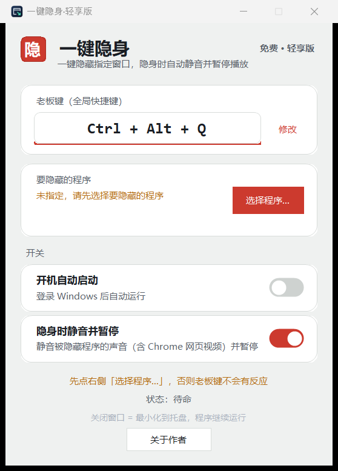

# 一键隐身 · 轻享版（BossKey Lite）

> 一个 Windows 老板键：按一下，指定的程序窗口全部消失、声音同时静音；再按一下，原样回来。
> 永久免费，MIT 协议开源。

[](https://github.com/jiongjiong123441/BossKey-Lite/actions/workflows/build.yml)


[](LICENSE)

<p align="center"></p>

## 功能

- **一键隐藏 / 恢复**：按全局快捷键（默认 `Ctrl + Alt + Q`），名单里的程序窗口立即隐藏；再按一次全部恢复显示。
- **只藏你选的程序**：在「选择程序…」里从正在运行的程序中勾选，也可以保留暂未运行的程序名。没有勾选的窗口一律不动。
- **隐身时静音并暂停**：通过 Windows Core Audio 把被隐藏程序的音频会话静音（包括 Chrome 里普通网页视频、广告这类不响应媒体键的声音），同时发送媒体暂停键；恢复时自动解除静音并继续播放。
- **藏得住**：隐藏期间被藏程序如果又弹出新窗口，会被立刻再次隐藏（WinEvent 事件钩子 + 低频兜底巡检）。
- **意外退出也不丢窗口**：隐藏状态会落盘，程序崩溃或被结束后，下次启动会把遗留的隐藏窗口恢复出来。
- **管理员程序**：目标程序以管理员身份运行时，普通权限无法隐藏它，托盘菜单提供「以管理员身份重启」。
- **其他**：快捷键可自定义（被占用时会提示）、开机自启、关闭窗口即最小化到托盘、高 DPI 清晰显示。
- **小巧**：单个 exe，绿色免安装，无第三方依赖。

## 下载

直接下载编译好的 exe：[Releases 最新版 BossKey-Lite.exe](https://github.com/jiongjiong123441/BossKey-Releases/releases/latest/download/BossKey-Lite.exe)

官网：<https://bosskey.pages.dev>

> **本软件永久免费。** 如果你是花钱买到的，说明有人在冒充本软件收费，请退款并举报。

## 使用

1. 运行 `BossKey-Lite.exe`。
2. 点「选择程序…」，勾选要隐藏的程序（比如浏览器、视频播放器、游戏）。
3. 按 `Ctrl + Alt + Q` 隐藏，再按一次恢复。点「修改」可以换成你习惯的组合键。

命令行参数：`--hide-now` 启动后立即执行一次隐藏（适合配合计划任务或快捷方式使用）。

配置保存在 `%AppData%\MoyuBossKeyLite\config.ini`，删除该目录即可恢复默认设置。开机自启写在
`HKCU\Software\Microsoft\Windows\CurrentVersion\Run` 下的 `MoyuBossKeyLite` 值，可在界面里关闭。

## 从源码构建

需要 Windows + [.NET SDK](https://dotnet.microsoft.com/download) 6 或更高版本（只用于编译；运行只需系统自带的 .NET Framework 4.7.2+，Windows 10/11 默认已有）。

```powershell
git clone https://github.com/jiongjiong123441/BossKey-Lite.git
cd BossKey-Lite
./build.ps1          # 等同于 dotnet build BossKeyLite.csproj -c Release -o dist
```

产物在 `dist\BossKey-Lite.exe`。也可以直接用 Visual Studio / Rider 打开 `BossKeyLite.csproj`。

## 代码结构

全部代码在 [`src/BossKeyLite.cs`](src/BossKeyLite.cs) 一个文件里（WinForms，纯 C#，所有界面都由代码创建，没有设计器文件）。主要的类：

| 类 | 作用 |
| --- | --- |
| `Program` | 入口：单实例互斥、恢复上次遗留的隐藏窗口 |
| `MainForm` | 主界面、托盘菜单、隐藏 / 恢复流程 |
| `HotKeyManager` / `HotKeyCaptureDialog` | 注册全局热键、录入新热键 |
| `WindowHider` | 枚举并隐藏 / 恢复目标进程的顶层窗口 |
| `WindowShowWatcher` | `SetWinEventHook` 监听窗口显示事件，隐藏期间新弹出的窗口立即再藏 |
| `HiddenStateStore` | 把隐藏状态写到磁盘，崩溃后恢复 |
| `AudioMute` | Core Audio（WASAPI）按进程静音 / 解除静音 |
| `AppCatalog` / `ProgramPickerDialog` | 列出可隐藏的程序并选择 |
| `AppConfig` | 读写 `config.ini` |
| `Native` | Win32 P/Invoke 声明 |
| `Ui` / `ToggleSwitch` / `RoundedPanel` | 界面配色、DPI 缩放和自绘控件 |

## 隐私

用本仓库源码编译出来的程序**完全不联网**：没有统计、没有遥测、没有自动更新，也不读取或上传窗口内容。只有你点「访问官网」「联系作者」时才会用默认浏览器打开对应链接。

## 局限

- 只隐藏窗口，不是安全工具：任务管理器里仍能看到进程，屏幕录制 / 截图软件也能照常工作。
- 以管理员身份运行的程序，需要本软件也以管理员身份运行才能隐藏。
- 「暂停播放」依赖程序支持系统媒体键（如 YouTube、网易云音乐）；不支持的只会被静音，不会暂停。

## 与完整版的区别

轻享版只保留核心的窗口隐藏和静音。防录屏 / 防截屏、隐藏托盘图标、隐藏悬浮窗等功能属于另行发布的完整版，不在本仓库中。

## 参与

欢迎提 Issue 和 Pull Request。提交 PR 前请确认 `./build.ps1` 能通过编译，并在 Windows 10 或 11 上实际试过隐藏 / 恢复。

## 联系作者

Telegram：[@ydnw6](https://t.me/ydnw6)

## 许可证

[MIT](LICENSE) © 2026 Dingjianbin
